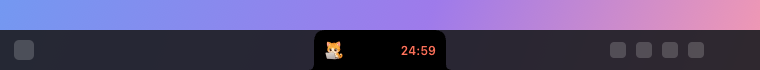
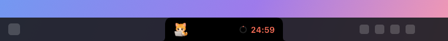
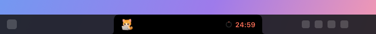
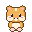
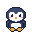
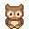
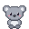
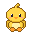
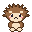

<div align="center">


# Focus Notch

**A Pomodoro timer that lives in your notch, with a cute focus friend that works alongside you.**

On macOS it wraps around the MacBook notch. On Windows it sits right in the taskbar.


</div>

## Contents

- [Features](#features)
- [Screenshots](#screenshots)
- [Focus friends](#focus-friends)
- [Download and install](#download-and-install)
- [How to use](#how-to-use)
- [macOS vs. Windows](#macos-vs-windows)
- [Development](#development)

## Features

- **A timer in the notch:** While a session runs, your pet sits on one side of the notch and the countdown on the other. Hover over it and the full panel opens.
- **The Pomodoro cycle:** Set the focus, short break and long break lengths, and how many sessions come before a long break. Breaks and focus sessions can start on their own.
- **Heads-ups on time:** When a break starts, when it ends, and **5 minutes before** the next focus session (adjustable), the notch shows an alert, plays a Focus Notch chime and sends a system notification.
- **Controls:** Start, pause, skip, reset, and **Finish** to end the session with a summary.
- **Focus friends:** 12 animals in two styles, cute and pixel art. They type on a laptop while you focus, nap during breaks and jump for joy when you finish. Click one to hear it. You can also add your own pet from up to four images (waiting, working, sleeping, celebrating); still images are turned into animated GIFs automatically.
- **Standard or compact:** Prefer a smaller notch? The compact design narrows the notch while a timer runs and shrinks the open panel. A live preview in Settings shows the difference.
- **Topics and statistics:** Pick what you're working on (Math, Coding…) and your focus time is logged under it. Charts per topic for today, this week and all time.
- **Themes:** Coral, Ocean, Forest, Lavender, Sunset and Mono.
- **23 languages:** English, Chinese (Simplified and Traditional), Hindi, Spanish, French, Arabic, Bengali, Portuguese, Russian, Urdu, Indonesian, German, Japanese, Turkish, Korean, Vietnamese, Italian, Persian, Polish, Ukrainian, Thai and Dutch.

## Screenshots

### macOS: in the MacBook notch

| During a session | Break alert |
| :---: | :---: |
|  |  |

### Windows: in the taskbar

The notch stands in the taskbar and grows upward when you hover over it. Pick the size that fits your taskbar:

| Small | Medium | Large |
| :---: | :---: | :---: |
|  |  |  |

<p align="center"></p>

### Settings

| Timer | Focus friend |
| :---: | :---: |
|  |  |
| **Statistics** | **General (Windows)** |
|  |  |

## Focus friends

Each pet plays a different animation depending on what the timer is doing:

| Idle | Focus | Break | Celebrate |
| :---: | :---: | :---: | :---: |
|  |  |  |  |

**Cute style**, illustrated with Codex:

<p>


</p>

**Pixel style**, retro pixel art:

<p>








</p>

Click your pet in the open panel to cheer it up; it answers with its own sound.

## Download and install

Ready-made builds are on the [**Releases**](https://github.com/metekaganmusaak/focus-notch/releases/latest) page. See [CHANGELOG.md](CHANGELOG.md) for what's new.

### macOS

1. Download **FocusNotch-macOS.zip** and unzip it.
2. Drag **FocusNotch.app** into your **Applications** folder.
3. The app isn't notarized by Apple, so macOS blocks it the first time. To open it, either:
   - try to open it once, then go to **System Settings → Privacy & Security** and click **Open Anyway** at the bottom, or
   - run this in Terminal:

     ```sh
     xattr -dr com.apple.quarantine /Applications/FocusNotch.app
     ```

4. Click **Allow** when it asks to send notifications.

Requires macOS 14 Sonoma or later. It looks best on MacBooks with a notch; on other screens it sits in the middle of the menu bar.

### Windows

The Releases page has two files:

| File | Use it for |
| --- | --- |
| **Focus.Notch.Setup.&lt;version&gt;.exe** | Everyday use. Installs in one click and adds a Start menu entry. |
| **Focus.Notch.&lt;version&gt;.exe** | Trying it out. A portable version that runs without installing. |

1. Download one and double-click it.
2. The app isn't code-signed, so SmartScreen may say "Windows protected your PC". Click **More info → Run anyway**.
3. The notch appears in the taskbar. The app's icon is in the notification area at the bottom right; if you don't see it, click the **^** arrow.

Requires 64-bit Windows 10 or 11.

## How to use

1. **Start:** Hover over the notch to open the panel and press the big ▶ button. You can also start from the menu bar icon (macOS) or the notification area icon (Windows).
2. **Pick a topic (optional):** Click a chip in the panel's topic row, or press **+** and type a new one. Your focus time is logged under it. Click the selected topic again to clear it.
3. **Focus:** When the panel closes, your pet types away on one side of the notch while the countdown runs on the other.
4. **Take a break:** When time's up, the notch says "Time for a break!" and plays a chime. Your pet naps during the break. You get another heads-up 5 minutes before the next session.
5. **Controls:**
   - ⏸ pauses and ▶ resumes.
   - ⏭ skips to the next phase.
   - ↺ restarts the current phase.
   - **Finish** ends the session and shows your total focus time and completed sessions.
6. **Pet your friend:** Click the pet in the open panel and it cheers and makes a sound.
7. **Settings:** Open them with the ⚙ button in the panel or from the icon menu.
   - **Timer:** Durations and auto-start.
   - **Focus Friend:** Pet, style, pet sounds, and adding your own pet from up to four images, one per mood (drag and drop works).
   - **Statistics:** Time per topic and managing topics.
   - **Notifications:** Notifications, sounds and the reminder lead time.
   - **General:** Language, launch at login, notch design (Standard or Compact, with a live preview) and theme. On Windows, also the notch position and size.

## macOS vs. Windows

| | macOS | Windows |
| --- | --- | --- |
| **Where it lives** | Around the MacBook notch; in the middle of the menu bar on screens without one | Inside the taskbar, as a virtual notch |
| **Opens** | Downward | Upward (downward if the taskbar is at the top) |
| **Position** | Fixed to the notch | **Settings → General → Notch position** (Left / Center / Right, plus a slider), or drag the open panel |
| **Default position** | Center | Left of the icons when Windows 11 centers them, otherwise center |
| **Size** | Matches the notch | Small, Medium or Large, to fit a busy taskbar |
| **Design** | Standard or Compact | Standard or Compact |
| **Control icon** | Menu bar (can be hidden) | Notification area |
| **Changing language** | Restarts the app | Applies instantly |
| **Built with** | SwiftUI + AppKit (native) | Electron |
| **Download size** | ~8 MB | ~115 MB |
| **Requires** | macOS 14 or later | 64-bit Windows 10 or 11 |

Everything else is the same on both: the timer logic, alerts and reminders, pets and their sounds, topics, statistics, themes and all 23 languages. The Windows app takes its pets, sounds and translations straight from the macOS project.

## Development

```
focus-notch/
├── macos/     SwiftUI + AppKit app, plus PetForge (generates pets, icon and chimes)
├── windows/   Electron app
└── docs/      README images
```

- **macOS:** Open `macos/FocusNotch.xcodeproj` in Xcode 16 or later and press ⌘R. Details in [macos/README.md](macos/README.md).
- **Windows:** `cd windows && npm install && npm start`. Build the installer with `npm run dist`. Details in [windows/README.md](windows/README.md).
- **Code structure and conventions:** [CLAUDE.md](CLAUDE.md)
- **Art and sound sources and their licenses:** [ASSETS.md](ASSETS.md)
- **What changed in each version:** [CHANGELOG.md](CHANGELOG.md)
