<div align="center">

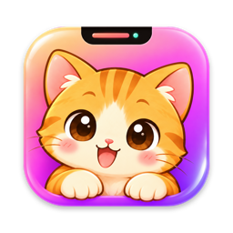

# Focus Notch

**Çentikte yaşayan, sevimli bir odak dostuyla birlikte çalışan Pomodoro zamanlayıcısı.**

macOS'ta MacBook çentiğinin etrafına, Windows'ta görev çubuğunun içine yerleşir.


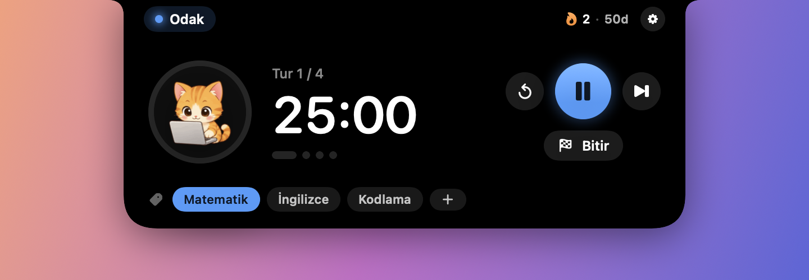

</div>

## İçindekiler

- [Özellikler](#özellikler)
- [Ekran görüntüleri](#ekran-görüntüleri)
- [Odak dostları](#odak-dostları)
- [İndirme ve kurulum](#i̇ndirme-ve-kurulum)
- [Kullanım](#kullanım)
- [macOS ve Windows farkları](#macos-ve-windows-farkları)
- [Geliştirme](#geliştirme)

## Özellikler

- **Çentikte zamanlayıcı:** Oturum sürerken çentiğin bir yanında pet, öbür yanında geri sayım görünür. Fareyle üzerine gelince panel açılır.
- **Pomodoro döngüsü:** Odak, kısa mola ve uzun mola süreleri ile uzun molanın kaç oturumda bir geleceği ayarlanabilir. Molalar ve odak oturumları istersen kendiliğinden başlar.
- **Zamanında haber:** Mola başlarken, mola biterken ve bir sonraki odak oturumundan **5 dakika önce** (süre ayarlanabilir) çentikte bir uyarı açılır, Focus Notch'a özel bir melodi çalar ve sistem bildirimi gelir.
- **Kontroller:** Başlat, duraklat, atla, sıfırla ve oturumu özetle kapatan **Bitir**.
- **Odak dostu:** 12 tatlı ve 6 piksel pet. Her biri odakta laptopta çalışır, molada uyur, oturum bitince zıplar. Bazılarına tıklayınca ses çıkarırlar. Kendi GIF'ini de ekleyebilirsin.
- **Konular ve istatistik:** Çalıştığın konuyu (Matematik, Kodlama…) seç; odak süren o konuya yazılsın. Bugün, bu hafta ve tüm zamanlar için konu bazında grafik.
- **Temalar:** Mercan, Okyanus, Orman, Lavanta, Gün Batımı ve Mono.
- **23 dil:** Türkçe, İngilizce, Çince (Basitleştirilmiş ve Geleneksel), Hintçe, İspanyolca, Fransızca, Arapça, Bengalce, Portekizce, Rusça, Urduca, Endonezce, Almanca, Japonca, Korece, Vietnamca, İtalyanca, Farsça, Lehçe, Ukraynaca, Tayca ve Felemenkçe.

## Ekran görüntüleri

### macOS: MacBook çentiğinde

| Oturum sürerken | Mola uyarısı |
| :---: | :---: |
|  | 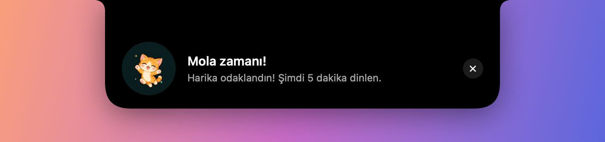 |

### Windows: görev çubuğunda

| Oturum sürerken | Fareyle üzerine gelince |
| :---: | :---: |
| 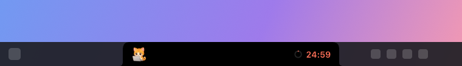 | 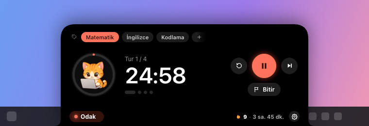 |

### Ayarlar

| Zamanlayıcı | Odak dostu |
| :---: | :---: |
| 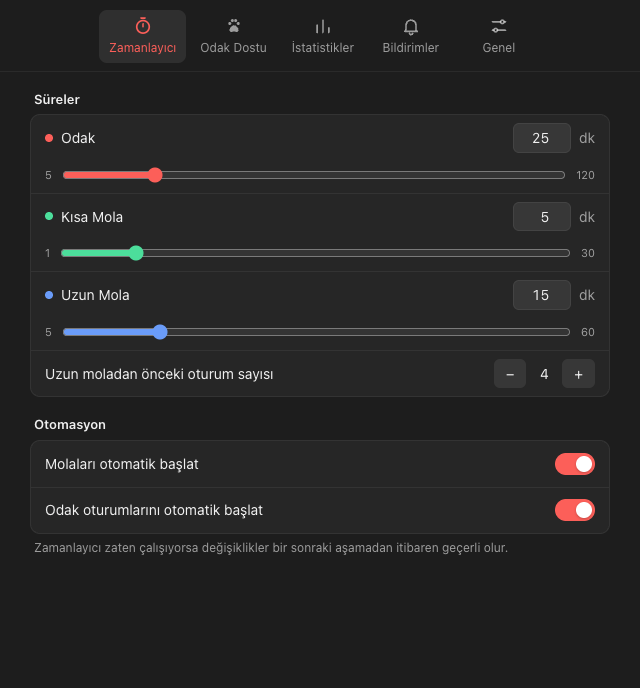 | 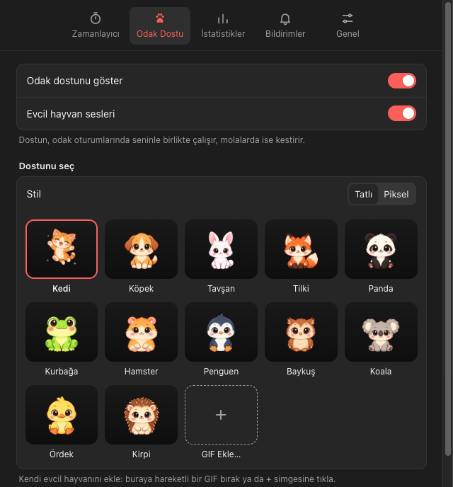 |
| **İstatistikler** | **Genel** |
| 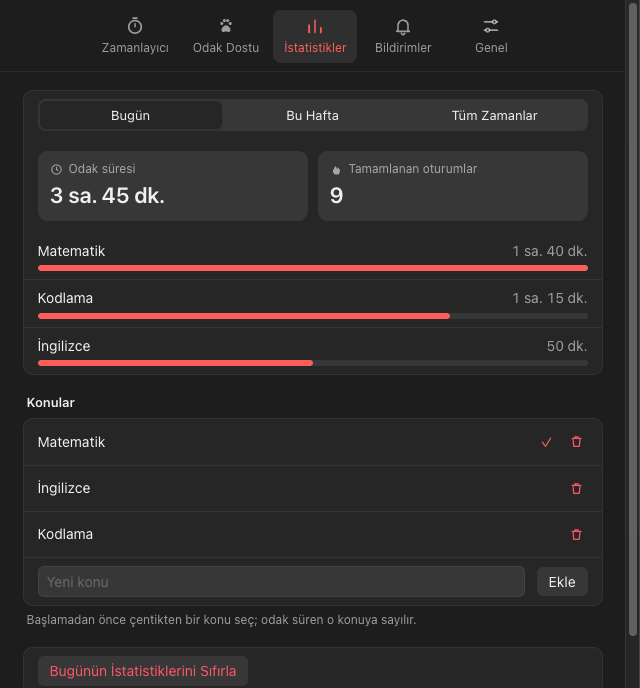 | 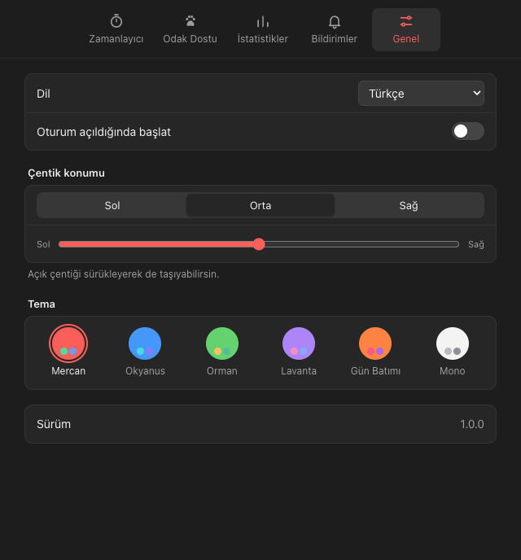 |

## Odak dostları

Pet'ler her zamanlayıcı durumuna göre farklı animasyon oynatır:

| Boşta | Odakta | Molada | Kutlamada |
| :---: | :---: | :---: | :---: |
|  |  |  |  |

**Tatlı stil**: Codex ile çizildi, 12 hayvan.

<p>


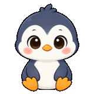
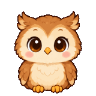
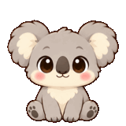


</p>

**Piksel stil**: retro piksel art, 6 hayvan.

<p>
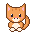
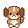
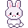
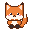

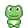
</p>

Kedi, köpek, kurbağa, ördek, baykuş ve hamstera tıklayınca ses çıkarırlar.

## İndirme ve kurulum

Hazır dosyalar [**Releases**](https://github.com/metekaganmusaak/focus-notch/releases/latest) sayfasında.

### macOS

1. Releases sayfasından **FocusNotch-macOS.zip** dosyasını indir ve aç.
2. Çıkan **FocusNotch.app** dosyasını **Uygulamalar** klasörüne sürükle.
3. Uygulama Apple tarafından onaylanmış (notarize) bir geliştirici hesabıyla imzalanmadığı için ilk açılışta macOS onu engeller. Açmak için:
   - Uygulamayı bir kez açmayı dene, sonra **Sistem Ayarları → Gizlilik ve Güvenlik** bölümünde en altta çıkan **Yine de Aç** düğmesine bas.
   - Ya da Terminal'de şunu çalıştır:

     ```sh
     xattr -dr com.apple.quarantine /Applications/FocusNotch.app
     ```

4. Bildirim izni istendiğinde **İzin Ver** de.

Gereksinim: macOS 14 Sonoma veya üstü. Çentikli MacBook'larda en iyi görünür; çentiksiz ekranlarda menü çubuğunun ortasında çalışır.

### Windows

Releases sayfasında iki dosya var:

| Dosya | Ne zaman |
| --- | --- |
| **Focus Notch Setup 1.0.0.exe** | Kalıcı kullanım. Tek tıkla kurulur, Başlat menüsüne eklenir. |
| **Focus Notch 1.0.0.exe** | Kurulum yapmadan denemek için taşınabilir sürüm. |

1. Dosyayı indirip çift tıkla.
2. Uygulama imzalı olmadığı için SmartScreen "Windows bilgisayarınızı korudu" diyebilir: **Ek bilgi → Yine de çalıştır**.
3. Çentik görev çubuğunda belirir. Uygulamanın simgesi sağ alttaki bildirim alanındadır; görünmüyorsa **^** okuna bak.

Gereksinim: 64-bit Windows 10 veya 11.

## Kullanım

1. **Başlat:** Fareyle çentiğin üzerine gel; panel açılır. Ortadaki büyük ▶ düğmesine bas. Menü çubuğu (macOS) ya da bildirim alanı (Windows) simgesinden de başlatabilirsin.
2. **Konu seç (isteğe bağlı):** Panelin konu satırındaki çiplerden birine tıkla ya da **+** ile yeni konu yaz. Bu oturumdaki odak süren o konuya yazılır. Seçili konuya tekrar tıklarsan seçim kalkar.
3. **Çalış:** Panel kapanınca çentiğin bir yanında pet laptopunda çalışır, öbür yanında sayaç akar.
4. **Mola:** Süre dolunca çentikte "Mola zamanı!" uyarısı açılır ve melodi çalar. Molada pet uyur. Sonraki oturumdan 5 dakika önce bir hatırlatma daha gelir.
5. **Kontroller:**
   - ⏸ duraklatır, ▶ devam ettirir.
   - ⏭ sonraki faza atlar.
   - ↺ süreyi baştan alır.
   - **Bitir** oturumu kapatıp toplam odak süreni ve tamamlanan oturum sayısını gösterir.
6. **Pet'i sev:** Paneldeki pet'e tıklarsan sevinir; bazıları ses çıkarır.
7. **Ayarlar:** Paneldeki ⚙ düğmesinden ya da simge menüsünden açılır.
   - **Zamanlayıcı:** Süreler ve otomatik başlatma.
   - **Odak Dostu:** Pet, stil, pet sesleri ve kendi GIF'ini ekleme (sürükle-bırak).
   - **İstatistikler:** Konu bazında süreler ve konu yönetimi.
   - **Bildirimler:** Bildirim, ses ve hatırlatma süresi.
   - **Genel:** Dil, girişte başlatma ve tema. Windows'ta çentik konumu da buradan değişir.

## macOS ve Windows farkları

| | macOS | Windows |
| --- | --- | --- |
| **Nerede durur** | MacBook çentiğinin etrafında; çentiksiz ekranda menü çubuğunun ortasında | Görev çubuğunun içinde (sanal çentik) |
| **Açılma yönü** | Aşağı doğru | Yukarı doğru (görev çubuğu üstteyse aşağı) |
| **Konum** | Sabit, çentiğin yeri | Ayarlar → Genel → Çentik konumu (Sol / Orta / Sağ ve kaydırıcı) ya da açık paneli sürükleyerek |
| **Varsayılan konum** | Ortada | Windows 11'de simgeler ortadaysa solda, aksi halde ortada |
| **Kontrol simgesi** | Menü çubuğunda (gizlenebilir) | Bildirim alanında (tray) |
| **Dil değiştirme** | Uygulama yeniden başlatılır | Anında uygulanır |
| **Teknoloji** | SwiftUI + AppKit (yerel uygulama) | Electron |
| **Boyut** | ~10 MB | ~115 MB |
| **Gereksinim** | macOS 14 veya üstü | 64-bit Windows 10 veya 11 |

Geri kalan her şey ortaktır: zamanlayıcı mantığı, uyarı ve hatırlatmalar, pet'ler ve sesleri, konular, istatistikler, temalar ve 23 dil. Windows sürümü pet'leri, sesleri ve çevirileri doğrudan macOS projesinden alır.

## Geliştirme

```
focus-notch/
├── macos/     SwiftUI + AppKit uygulaması ve PetForge (pet, ikon ve ses üretici)
├── windows/   Electron uygulaması
└── docs/      README görselleri
```

- **macOS:** `macos/FocusNotch.xcodeproj` dosyasını Xcode 16 veya üstüyle açıp ⌘R. Ayrıntılar: [macos/README.md](macos/README.md)
- **Windows:** `cd windows && npm install && npm start`. Kurulum dosyası için `npm run dist`. Ayrıntılar: [windows/README.md](windows/README.md)
- **Kod yapısı ve kurallar:** [CLAUDE.md](CLAUDE.md)
- **Görsel ve ses kaynakları ile lisansları:** [ASSETS.md](ASSETS.md)
